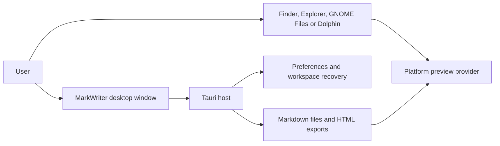
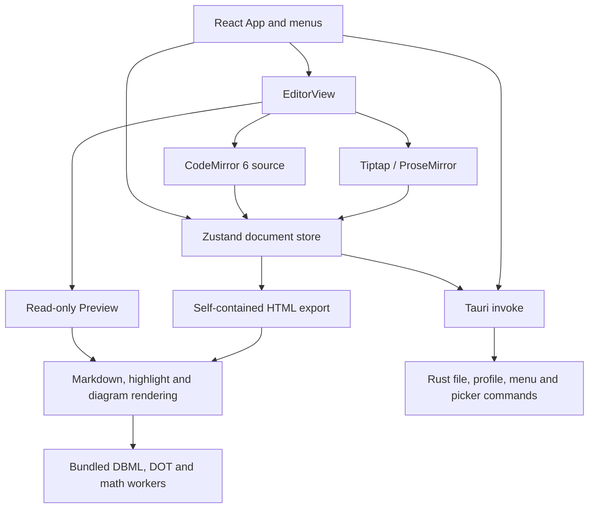
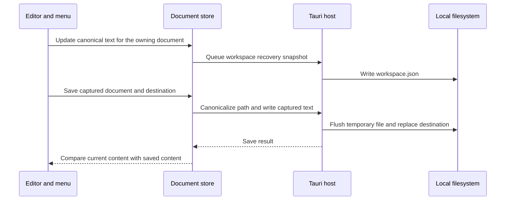
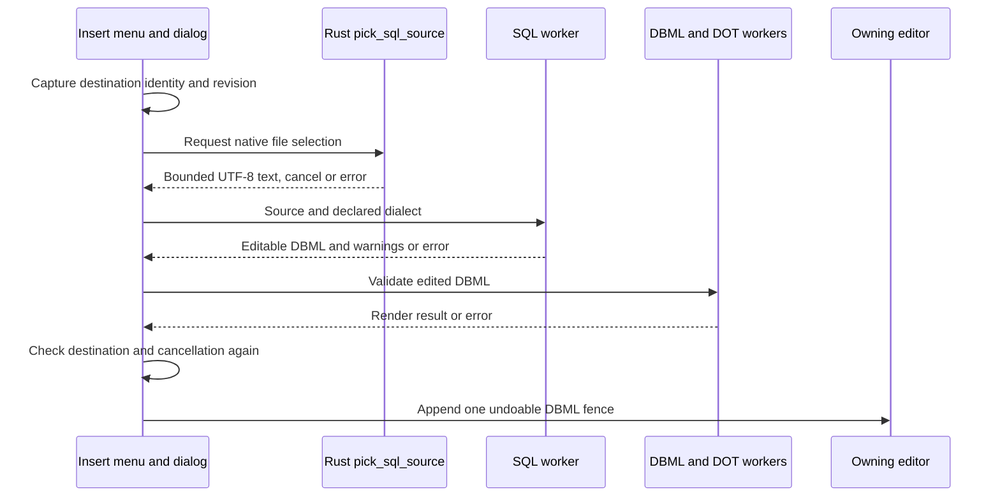
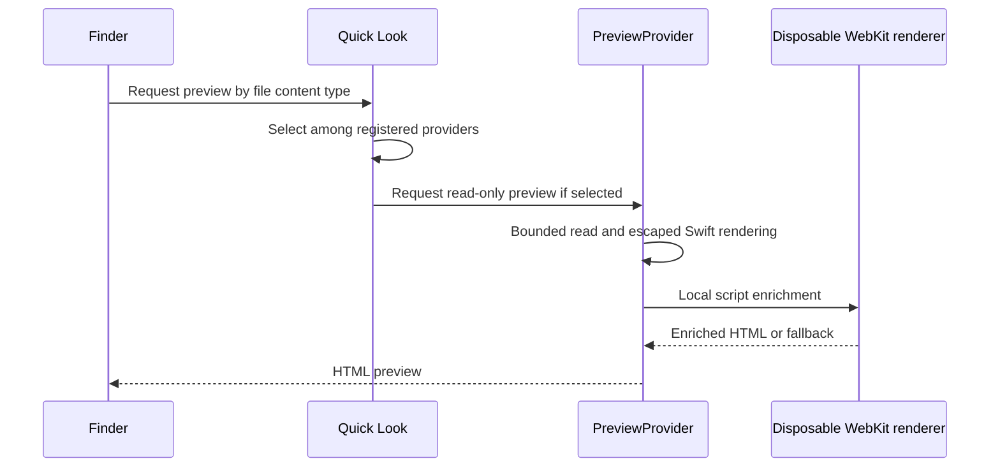
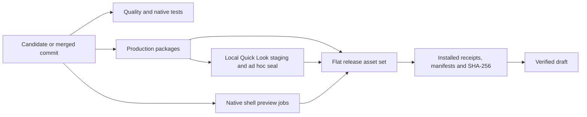

# MarkWriter architecture

MarkWriter's desktop window runs React in the Tauri WebView. The application owns canonical Markdown in a per-document store. OS previews run in their respective shells and can render a file with the editor closed.

## Context

## Application structure

| Source | Responsibility |
| --- | --- |
| [`frontend/src/components/`](../frontend/src/components/) | Menus and dialogs, editor adapters, read-only Preview and diagram components |
| [`frontend/src/store/`](../frontend/src/store/) | Documents, active identity, revision, destination ownership and captured saves |
| [`frontend/src/lib/`](../frontend/src/lib/) | Markdown conversion and correspondence, highlighter, local workers, export and persistence client |
| [`src-tauri/src/`](../src-tauri/src/) | Tauri command registration, native menus, file writes, OS-open events, picker, profile and update policy |
| [`native/`](../native/) | Finder extension, Explorer handler, Sushi viewer and Dolphin thumbnailer |
| [`tools/`](../tools/) and [`.github/workflows/`](../.github/workflows/) | Build, package, acceptance, notices and release tooling |

## Save and recovery

A tab switch does not redirect a save already in flight. Recovery and discard track the captured owning document and revision. Preview derives from canonical text. Read [document ownership](document-ownership.md) and [Preview correspondence](preview-correspondence.md) for the edge cases.

## SQL DDL import

The [picker](../src-tauri/src/sql_import.rs), [worker client](../frontend/src/lib/sqlDdlClient.ts) and [menu integration](../frontend/src/components/MenuBar.tsx) enforce distinct input, deadline and ownership boundaries. The [import guide](sql-import-preview.md) describes the supported DDL subset.

## Finder preview and release packages

The [extension plist](../native/quicklook/Info.plist) advertises supported types. The [provider](../native/quicklook/PreviewProvider.swift) owns file reading and delegates enrichment to [QuickLookWebRenderer](../native/quicklook/QuickLookWebRenderer.swift). Selection and rendering are separate checks. See the [shell preview matrix](shell-preview-matrix.md).

The [production workflow](../.github/workflows/tauri-prerelease.yml) includes the Explorer package acceptance, while [shell previews](../.github/workflows/shell-previews.yml) exercises Explorer diagnostics and builds and tests Sushi and Dolphin. Mac staging from CI provides separate evidence from the final locally sealed DMG. [Release tooling](../tools/release-metadata.mjs) checks manifests and aggregates exact-source assets.

Graphify is a local navigation aid for code relationships. It does not establish IPC command registration, worker protocols, preview metadata or workflow behavior. The diagrams above use the owning source and configuration for those edges.
