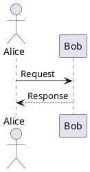
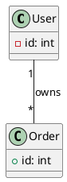

# Markdown and editing

Markdown is the canonical document. Opening, searching, selecting, scrolling, folding, changing settings and switching modes do not rewrite it. A genuine WYSIWYG edit serializes supported structure and may normalize whitespace, list markers, fences and tables; use source mode where exact syntax matters.

MarkWriter supports common Markdown and GFM tables, tasks, fenced code, Mermaid and offline [DOT](dot-security.md) and [DBML](dbml-2.7.md) diagrams, plus explicit math fences. Use **Help → User Guide** for editing instructions and feature limits. Diagram and math rendering is bounded; unsupported or oversized input remains readable as source. HTML export is self-contained and contains static diagram output.

Find and Replace is scoped to the current document. Source mode searches Markdown, including folded content; rendered mode searches editable text and excludes opaque diagram interiors. See [regular-expression search](regex-search.md) for syntax, limits and replacement behavior. The source and rendered editor fonts are independent display settings.

### Offline PlantUML sequence and class diagrams

Put one diagram between `@startuml` and `@enduml` in a fenced `plantuml` block. Edit the source in Markdown. WYSIWYG and Preview render supported diagrams locally, and HTML export saves their static SVGs. If a diagram uses unsupported syntax or the renderer cannot validate its output within budget, its source stays readable.

````markdown



````

Sequence diagrams accept declared actors and participants with labeled solid or dashed messages. Class diagrams accept named classes, public and private typed fields, and labeled associations with optional quoted multiplicities. Use ASCII identifiers of up to 32 characters. Themes, includes, images, macros, other diagram families and mixed diagram types retain their source.

Each PlantUML fence has an 8 KiB UTF-8 input limit and a 200-line limit. The app and HTML export render at most four PlantUML blocks totaling 16 KiB per document. The app checks the queue, render and SVG validation against a five-second job deadline. Finder shares its four diagram slots with Mermaid, DOT and DBML. Its native enrichment deadline is eight seconds, and its existing whole-file limits apply.

### Explicit Java, Perl, AWK and CMake fences

Use `java`, `perl` (or `pl`), `awk` or `cmake` as the fence label to highlight these languages in both editors, Preview and offline HTML export. Labels are case-insensitive. The standard limit is 4,096 UTF-16 code units per fence and 2,048 per line, with a shared 16,384-unit budget for ordinary fences. `sed` and fences that exceed these limits remain readable as plain text.

### Large explicit SQL fences

Both editors, Preview and HTML export can highlight one explicitly labeled SQL fence up to 131,072 UTF-16 code units. Explicit SQL shares that budget across the document. Each line can contain up to 2,048 UTF-16 code units and each fence can produce up to 24,576 styled spans. The highlighter considers at most 64 code blocks per document pass. If a bound is exceeded, the affected SQL remains readable as literal source with a highlighting notice. Source bytes and edit history stay with the document.

Finder uses a separate bounded renderer. The per-fence and span limits above also apply there, with up to 262,144 UTF-16 units of ordinary highlighted code in aggregate, 16,384 UTF-16 units per line and 65,536 aggregate spans. The whole-file read, WebKit enrichment and deadline limits also apply. SQL import uses a separate [128 KiB UTF-8 file limit](sql-import-preview.md).

### Large explicit TOML fences

Both editors, Preview and self-contained HTML export highlight explicit TOML fences up to 131,072 UTF-16 code units across a document pass. Each fence can have up to 4,096 lines, with up to 2,048 UTF-16 code units per line. Before tokenizing, the highlighter budgets up to 8,192 syntax markers per document pass, including punctuation, numbers and boolean keywords even inside strings and comments. Both live editors apply up to 4,096 styled spans per pass. Preview and HTML export apply up to 12,288. The highlighter considers at most 64 code blocks per pass. Fences that exceed the limits keep their full text and show a highlighting notice. UTF-8 byte sizes vary with the characters used.

Highlighting runs locally. Large TOML fences in Markdown refresh after a short pause. Preview coalesces source edits for large documents and drops pending work when the active tab changes. HTML export renders the captured document revision. Finder uses a separate highlighting budget.
