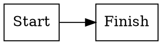

# Markdown and editing conventions

The 2.1.0-alpha3 candidate keeps Markdown canonical. Opening, searching, selecting, scrolling, folding, changing Settings or switching modes does not normalize or rewrite it. Genuine WYSIWYG edits serialize supported semantics and may normalize blank lines, list markers, indentation, fence choice and table layout. Use source mode when exact syntax beyond the supported subset matters.

Supported: ATX headings, paragraphs, bold/italic/strike, inline/fenced code, quotes, nested bullet/ordered/task lists, links, embedded images, GFM tables/alignment, Mermaid fences and the DOT subset below. `++text++` is underline. Table cells can contain the narrowly allowed safe ` ` line break. Arbitrary HTML is displayed literally, not executed; merged cells and arbitrary HTML styling are outside this subset.

WYSIWYG typing and plain-text paste are literal, including `# `, `> `, `- `, `1. `, fences, emphasis and links. Toolbar/menu actions and editor keyboard shortcuts apply formatting. Enter continues existing lists/tasks; automatic Markdown input and paste rules and automatic link detection are disabled. Serialization escapes literal syntax, including extension delimiters. Source typing remains Markdown syntax.

Code acts on complete selected source lines (an endpoint at the next line's beginning excludes that line). It wraps one fence longer than any selected backtick run; toggling inside a fence unwraps that fence. In WYSIWYG, sibling selected paragraphs become one code block with newline-separated text. Blocks in different cells or list parents are deliberately not flattened into one block; format within the individual cell/list item. Explicit formatting collapses the caret at the transformed content end, rather than moving to document end. Native Undo/Redo retains engine ownership per tab.

The table picker begins at 5 × 5. Pointer movement grows/shrinks the visible area; arrows resize, Enter inserts, Escape/Cancel/outside click dismiss. Rows include the header. The visible grid is viewport bounded; numeric fields and arrow keys reach the supported 40 × 40 insertion limit. Larger tables can be extended with contextual table commands. Inserted dimensions are identical in both editing modes.

Find searches the current tab only. Markdown scope includes all canonical source and folded payloads, including pasted multiline queries. WYSIWYG scope is editable text inside each text block; matches may cross inline marks but stop at atoms/hard breaks/block boundaries. Search source explicitly to access diagram internals. Literal queries, case/whole-word options, wrapping next/previous, current replacement and one-step Replace All are supported; regular expressions and project search are deferred.

GFM permits multiple spaces after a list marker and four-space nesting. Those forms are not corruption. Practical markdownlint configuration may disable MD013 (line length, especially URLs/diagram/data payloads), MD024 (repeated headings), MD033 only for the documented table ` ` extension, and MD046 when accepting both valid code forms. Set MD004/MD007/MD030 to the team's chosen list style or disable style-only checks for normalized WYSIWYG output. Do not rewrite user documents solely to satisfy lint. Source and rendered fonts are independent display settings, not document formatting.

## Ordinary code highlighting (alpha3 candidate)

The `{ }` toolbar button and **View → Syntax highlighting** control one saved preference, on by default. It applies to source code blocks, WYSIWYG, Preview and HTML export. **View → Theme → Auto / Light / Dark** follows the same choice as Settings; Auto responds to the system appearance. Source and rendered text sizes remain independent.

Supported languages: C, C++, C#, Objective-C, SQL, Bash, Zsh (using the Bash grammar), Rust, Python, Go, YAML, JSON, XML, JavaScript, TypeScript, Dockerfile, CSS, Swift and Makefile. Prefer an explicit fence such as `js`, `python`, `cpp`, `csharp`, `objective-c`, `bash`, `zsh`, `yaml`, `json`, `xml`, `ts` or `dockerfile`. Common registered aliases are accepted, including `m` for Objective-C. The first fence-info word chooses the language; later metadata does not change it.

Only unlabeled ordinary code is detected automatically, with a conservative confidence threshold. Ambiguous results stay plain. Explicit `text`, unsupported names and reserved diagram formats remain plain or use their existing diagram path; automatic detection never changes the fence language or source. Highlighting is presentation only, and code that resembles HTML or JavaScript is displayed literally.

To keep presentation work bounded, explicit blocks over 4 Ki UTF-16 units, automatic blocks over 2 Ki, and any block with a line over 2 Ki stay plain. A rebuild also limits total work to 16 Ki units, 64 blocks and 4 automatic blocks. Source is never truncated. These limits do not guarantee a hard lexer time deadline. Self-contained HTML uses a fixed readable light palette with inline styles and no highlighting scripts or network requests. Turning highlighting off exports plain code. Broader unlabeled-code detection and additional Java/Perl/AWK/sed/CMake coverage are tracked in [#44](https://github.com/rheiger/markWriter/issues/44).

In rendered code blocks, inline code and block quotes, text assistance is requested off on the active editing host and cancelable, noncomposing automatic replacement input is rejected, including queued replacements targeting technical text after the caret moves. Normal typing, intentional Unicode, paste and IME composition remain literal input. Source editing keeps its existing assistance-off policy. Native OS behavior is qualified separately in [feedback acceptance](alpha3-feedback-acceptance.md). Genuine WYSIWYG serialization still collapses repeated spaces in inline code and ordinary prose; [#46](https://github.com/rheiger/markWriter/issues/46) tracks the code-fidelity defect. Use source editing for exact whitespace.

## Offline DOT / Graphviz

Use a fenced `dot` block (`graphviz` is an alias). The source stays editable in Markdown; WYSIWYG treats the diagram as an opaque atom. Preview clicks and source selection use an explicit dashed block fallback, with no invented text positions inside SVG. Source Find includes folded notation; rendered Find excludes atom internals. View-only changes preserve the original fence/alias/line endings. A genuine rendered edit preserves the graph source but can normalize enclosing Markdown, as with other supported blocks.

**Insert → Diagram → DOT** inserts a small directed graph. Switch to Markdown to edit its source; Undo removes the insertion in one operation. In source mode the starter replaces the current selection; insert outside an existing code fence. In WYSIWYG it inserts after the current block, including after a table.

The bundled Viz3.31.0 / Graphviz16.1.0 runtime uses the `dot` layout engine locally, with no hosted renderer, upload, Graphviz installation or runtime download. Limits:64KiB UTF-8 source,2MiB SVG,2s layout after up to5s startup,32 waiting jobs. A worker is terminated on timeout/cancellation; JavaScript/WASM does not provide a hard memory bound. Malformed, empty, unsupported or oversized notation remains intact with an inline recoverable error. Simplify the graph or edit its source.

Supported attributes are deliberately restricted: labels/tooltips, rank/direction/spacing, shape/style, colors/fonts, line/arrow properties, dimensions/margins and ordinary cluster/edge layout options listed in the [DOT safety ADR](adr-offline-dot.md). External images/files, links/URLs, include/resource settings, HTML labels, concatenated strings, gradient/multicolor paints, radial styles and unknown attributes are rejected. Unsupported Graphviz features/warnings also fail closed. Unicode labels retain their text; the embedded runtime's approximate non-ASCII metrics can affect glyph fit and do not guarantee identical typography across installed fonts.

HTML export embeds sanitized static SVG, strips diagram source/mapping metadata and needs no renderer script. Ordinary document links remain active in exported HTML. DOT's SVG is reconstructed from a small geometry/text subset; scripts, handlers, foreign objects, resource URLs and CSS are removed. The canvas remains white in both UI themes to preserve explicit diagram colors.
