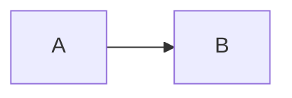
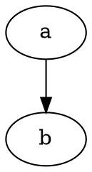

# Technical writing acceptance

Literal code: `a  b`, `a	b`, `   ` and `` `tick`  text ``.

```math
\frac{1}{2} + \alpha_1^2 = \beta
```

```math
\begin{pmatrix} a & b \\ c & d \end{pmatrix}
```

```math
\begin{aligned} E &= mc^2 \\ f(x) &= \int_0^1 x^2\,dx \end{aligned}
```

```math
\text{Grüße} + \Omega + x_{i+1}^{n-1}
```

```math
\sum_{i=1}^{n} a_i = x_i + x_i + x_i + x_i + x_i + x_i + x_i + x_i + x_i + x_i + x_i + x_i + x_i + x_i + x_i + x_i + x_i + x_i + x_i + x_i + x_i + x_i + x_i + x_i + x_i + x_i + x_i + x_i + x_i + x_i + x_i + x_i + x_i + x_i + x_i + x_i + x_i + x_i + x_i + x_i + x_i + x_i + x_i + x_i + x_i + x_i + x_i + x_i + x_i + x_i + x_i + x_i + x_i + x_i + x_i + x_i + x_i + x_i + x_i + x_i + x_i + x_i + x_i + x_i + x_i + x_i + x_i + x_i + x_i + x_i + x_i + x_i + x_i + x_i + x_i + x_i + x_i + x_i + x_i + x_i + x_i + x_i + x_i + x_i + x_i + x_i + x_i + x_i + x_i + x_i + x_i + x_i + x_i + x_i + x_i + x_i + x_i + x_i + x_i + x_i + x_i + x_i + x_i + x_i + x_i + x_i + x_i + x_i + x_i + x_i + x_i + x_i + x_i + x_i + x_i + x_i + x_i + x_i + x_i + x_i + x_i + x_i + x_i + x_i + x_i + x_i + x_i + x_i + x_i + x_i + x_i + x_i + x_i + x_i + x_i + x_i + x_i + x_i + x_i + x_i
```

Ordinary dollars $5 and $$x$$ remain literal.

```js
const value = "<safe>";
```




